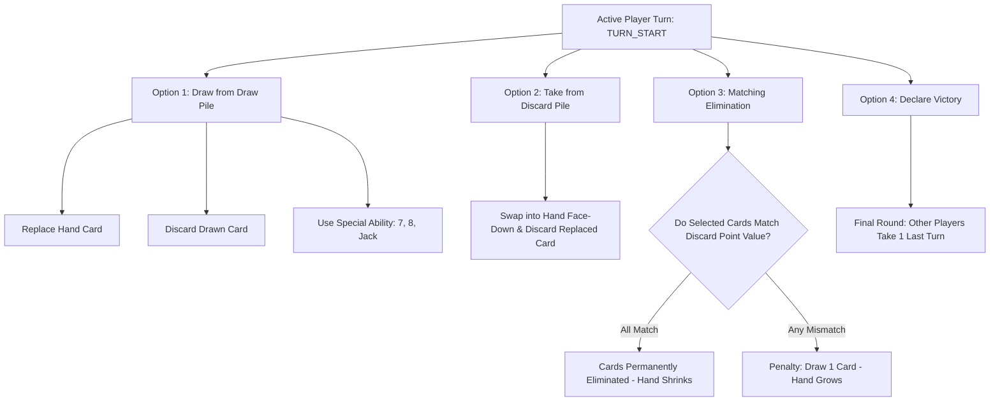

# 🎴 Six Cards — Official Game Rules, Mechanics & System Conditions

This document is the **authoritative reference** for the Six Cards card game application. It details the complete rule set, exact card point values, deck scaling by player count, turn life cycle options (including an in-depth breakdown of **Option 2: Take from Discard Pile**), special card powers, matching elimination rules, end-game scoring, and multiplayer systems.

---

## 1. Game Objective

The goal of **Six Cards** is to finish the game with the **lowest total hand point score**, or achieve an **instant zero-card automatic victory** by successfully eliminating all cards in your hand.

---

## 2. Deck Composition & Player Scaling

* **Cards Used**: Standard 52-card decks (no Jokers) with four standard suits: ♠️ Spades, ♥️ Hearts, ♦️ Diamonds, ♣️ Clubs.
* **Deck Scaling by Player Count** *(implemented in `deck.ts`)*:
  * **2 Players**: **1 Deck** (52 cards)
  * **3 to 4 Players**: **2 Decks** (104 cards)
  * **5 to 6 Players**: **3 Decks** (156 cards)
* **Dealing**: Each player is dealt **6 cards face down** in a fixed arrangement (Positions 1 through 6).
* **The Center Table**:
  * **Draw Pile**: Placed face down in the center of the table.
  * **Discard Pile**: Starts with **1 card turned face up** from the draw pile at the start of the match.
  * **Eliminated Zone**: Holds all cards that have been successfully eliminated from player hands during matching eliminations.

---

## 3. Exact Card Point Values

Scoring is strictly based on the authoritative game engine implementation (`scoring.ts`):

| Rank / Card | Point Value | Strategic Role & Elimination Note |
| :--- | :---: | :--- |
| **King (K)** | **0 pts** | 🏆 **Best card in the game!** Adds 0 points to your total (all suits: ♥️ ♦️ ♠️ ♣️). Matches other Kings during elimination. |
| **Ace (A)** | **1 pt** | Ultra-low point card. Matches other Aces during elimination. |
| **2 to 9** | **2 to 9 pts** | Exact face value (e.g. `2` is 2 pts, `7` is 7 pts, `9` is 9 pts). |
| **10** | **10 pts** | High point card. **Matches both 10s and Queens** during elimination (both equal 10 pts). |
| **Queen (Q)** | **10 pts** | High point card. **Matches both Queens and 10s** during elimination (both equal 10 pts). |
| **Jack (J)** | **40 pts** | ⚠️ **Highest risk card!** Carries a 40-point penalty if held at the end of the game. Has the special **Blind Exchange** power when drawn from the deck. |

> [!NOTE]
> **Point-Value Matching**: During elimination, cards match **strictly by point value**, not rank or suit. For example:
> - A **Queen (10 pts)** matches a **10 (10 pts)**.
> - A **King (0 pts)** matches another **King (0 pts)**.
> - A **5 of Spades (5 pts)** matches a **5 of Hearts (5 pts)**.

---

## 4. Game Setup & Initial Memorization Phase

1. Every player is dealt **6 face-down cards** in fixed slots numbered 1 through 6.
2. **Initial Memorization Phase**:
   - Before Round 1 begins, each player privately selects and views **exactly 2 of their own cards**.
   - Players memorize the values and positions of these 2 cards.
   - The 2 cards are flipped back face down.
   - The remaining 4 cards remain unknown mysteries until revealed by abilities or replacements.
3. **Player Privacy Guarantee**:
   - In Multiplayer and Pass & Play, memorization is strictly private. Network data masks opponent cards so no other player can see what was inspected.

---

## 5. Turn Life Cycle & The Four Player Actions

Play proceeds clockwise. On a player's turn at **`TURN_START`**, the active player chooses **ONE** of the following four primary actions:

---

### Option 1: Draw from Draw Pile (`DRAW`)

1. **Draw Action**: The player draws the top face-down card from the Draw Pile.
2. **Privacy Masking**:
   - **Only the drawing player sees the card face up.**
   - All opponents see a generic hidden card (`🔒 Secret Card`), and rank/suit data is masked over WebSocket network packets.
3. **Sub-Actions with the Drawn Card**:
   - **A. Replace Hand Card (`REPLACE`)**: Swap the drawn card into any hand position (1 through 6). The drawn card is placed face down into that slot, and the old card from that slot is placed face up on top of the Discard Pile.
   - **B. Discard Directly (`DISCARD`)**: Place the drawn card directly face up onto the Discard Pile.
   - **C. Trigger Special Ability** *(if drawn card is a 7, 8, or Jack)*: Discard the card and immediately execute its unique power (see Section 6).

---

### Option 2: Take from Discard Pile (`REPLACE_FROM_DISCARD`)

#### In-Depth Explanation & Mechanics:

Option 2 allows the active player to bypass the uncertainty of drawing an unknown card from the deck and instead **claim the known, top face-up card on the Discard Pile**.

#### 1. When Can Option 2 Be Chosen?
- Option 2 is available at **`TURN_START`** whenever the Discard Pile contains at least one card.
- The player does **not** draw from the Draw Pile when choosing Option 2.

#### 2. Exact Step-by-Step Execution:
1. **Inspection**: The player reviews the top face-up card of the Discard Pile (its rank, suit, and point value are 100% visible and verified).
2. **Selection**: The player selects Option 2 and chooses **one target card position** in their own hand (positions 1 through 6, or any remaining active slot).
3. **The Swap**:
   - The top card of the Discard Pile is removed from the discard stack and placed into the player's chosen hand slot face down.
   - The old card previously occupying that hand slot is removed and placed **face up on top of the Discard Pile**.
4. **New Discard State**: The replaced card now becomes the **new top card of the Discard Pile**, immediately visible and available to subsequent players.
5. **Turn Completion**: The turn ends, and play advances clockwise to the next player.

#### 3. Critical Rule: NO Special Abilities from Discard Pile
> [!IMPORTANT]
> **Special abilities (7, 8, and Jack) DO NOT trigger when taken from the Discard Pile.**
> - Special powers only trigger when a card is drawn fresh from the **Draw Pile** and discarded.
> - If an opponent discards a **Jack**, and you take it via Option 2, **you cannot use the Jack Blind Exchange ability**. Instead, that 40-point Jack enters your hand as a severe point liability!
> - If an opponent discards a **7** or **8**, taking it puts a 7-pt or 8-pt card into your hand without granting a peek.

#### 4. Strategic Advantages of Option 2:
- **Zero Risk / Deterministic Knowledge**: Unlike drawing from the deck (which could yield a disastrous 40-pt Jack or high card), taking from the discard provides a **guaranteed point value**.
- **Snatching Low-Point Cards**: If an opponent discards a **King (0 pts)**, **Ace (1 pt)**, or **2 (2 pts)**, you can immediately grab it to replace an unknown or high card in your hand.
- **Knowledge Refresh**: If you replace a card whose value you didn't know, you now know the exact value of your new card, and the old card is revealed on the discard pile.
- **Preparing Elimination Traps**: You can pick up a card to pair with other cards in your hand, preparing for a future matching elimination.

---

### Option 3: Matching Elimination (`SELECT_ELIMINATION`)

Option 3 is the primary way to **shrink your hand** and work toward an **Automatic Zero-Card Victory**.

1. **The Target Value**: The top face-up card of the Discard Pile establishes the **target point value**.
2. **Card Selection**: The active player selects 1 or more face-down cards from their hand that they believe have the **exact same point value** as the top discard card.
3. **All-or-Nothing Evaluation**:
   - **SUCCESS (All Cards Match)**:
     - All selected cards are revealed and permanently moved to the **Eliminated Zone**.
     - The player's hand size shrinks by the number of eliminated cards.
     - If the player's hand reaches **0 cards**, they win immediately with an **Automatic Zero-Card Victory**!
   - **FAILURE (Any Card Mismatches)**:
     - If **even one** selected card does not match the target point value, the entire elimination attempt fails.
     - **None** of the selected cards are eliminated.
     - The player is penalized: **1 penalty card is dealt face down from the Draw Pile into their hand**.
     - The player's hand size increases by 1!
4. **Matching Examples**:
   - Top discard is a **Queen (10 pts)**: Player selects a **10** and a **Queen** from hand -> **Success! Both eliminated.**
   - Top discard is a **King (0 pts)**: Player selects two **Kings** -> **Success! Both eliminated.**
   - Top discard is a **7 (7 pts)**: Player selects a **7** and an **8** -> **Failure! 8 is 8 pts; 1 penalty card dealt.**

---

### Option 4: Declare Victory (`DECLARE_VICTORY`)

1. **Availability**: Can only be chosen at **`TURN_START`** after **Round 1 is fully completed** (every player has taken at least one turn).
2. **Execution**:
   - If a player believes their hand score is the lowest at the table, they declare victory.
   - The declaring player's hand is locked, and their turn ends.
3. **The Final Round**:
   - **Every other player receives exactly ONE final turn** to optimize their hand, replace high cards, or attempt eliminations.
   - The declarer takes no further turns.
4. **Resolution**: All hands are revealed, and final scores are evaluated (see Section 7).

---

## 6. Special Card Abilities (7, 8, Jack)

Special abilities trigger **only when the card is drawn from the Draw Pile and discarded**:

### 🔍 Seven (7) — Self Peek (`SPECIAL_ABILITY_7`)
- **Ability**: Secretly view **one of your own face-down cards**.
- **Privacy**: Only you see the revealed card; opponents see nothing.
- **Utility**: Re-verify a forgotten card position or discover an unrevealed mystery card.
- **Outcome**: The 7 is placed face up on the Discard Pile, and your turn ends.

### 👁️ Eight (8) — Opponent Peek (`SPECIAL_ABILITY_8`)
- **Ability**: Secretly view **one face-down card belonging to any opponent**.
- **Privacy**: Only you see the card value. The targeted opponent is notified that a card was viewed, but not which value was seen.
- **Utility**: Scout an opponent's hand to identify low cards (like Kings or Aces) to steal later, or locate high cards to avoid.
- **Outcome**: The 8 is placed face up on the Discard Pile, and your turn ends.

### 🔄 Jack (J) — Blind Exchange (`SPECIAL_ABILITY_JACK`)
- **Ability**: Swap **one of your cards** with **one opponent's card**.
- **Condition**: Performed **completely blind** — neither player views the face of either card during the exchange.
- **Privacy**: Both cards are swapped face down between hands.
- **Utility**: Transfer your known high cards (40-pt Jacks, 10-pt Queens, or high numbers) to an opponent, while taking a card you suspect is low.
- **Outcome**: The drawn Jack is placed face up on the Discard Pile, and your turn ends.

---

## 7. Victory Conditions & Scoring Evaluation

A match can conclude in one of three ways:

### A. 🏆 Automatic Zero-Card Victory (`ZERO_CARD_AUTOMATIC_VICTORY`)
- If any player successfully eliminates all cards from their hand down to **0 cards**:
- The game ends **immediately**.
- That player wins automatically with **0 points**. No final round is played.

### B. 🏁 Declared Victory Resolution (`DECLARED_VICTORY`)
At the end of the final round, all cards of all players are flipped face up, and hand totals are summed:
1. **Successful Call**: If the declaring player has the **strictly lowest hand score**:
   - The declaring player wins the match!
2. **Failed Call / Undercut**: If any opponent has an **equal or lower hand score** than the declaring player:
   - The declaring player incurs a **+10 point penalty** added to their score.
   - The opponent with the lowest score wins the match!
3. **Ties**: If two non-declaring opponents tie for the lowest score, both are declared joint winners (a draw).

### C. 📦 Draw Pile Exhaustion (`DRAW_PILE_EMPTY`)
- If the Draw Pile runs out of cards during a draw or penalty action:
- **Discards are NOT reshuffled into a new draw pile.**
- The game ends immediately.
- All cards are revealed, and the player with the lowest total score wins.

### D. ⚠️ Six Incorrect Elimination Attempts Automatic Defeat (`SIX_WRONG_ATTEMPTS`)
- Every incorrect elimination attempt adds 1 penalty card to the player's hand and increments that player's mistake counter.
- If any player accumulates **6 incorrect elimination attempts**, that player **automatically loses the match immediately**.
- The opponent is declared the winner regardless of current card values.

---

## 7.1 Bot Mode Specific Rules & Flow
In 1v1 Bot Mode (Human vs System AI):
1. **Turn Order**: The bot plays **first** (`Bot Turn 1`). The human player plays **second** (`Player Turn 1`).
2. **First Round Lifecycle**: Round 1 is complete only after both the bot and the human player have completed one turn each.
3. **Victory Button Visibility**: The Victory button is **hidden during Round 1**. It becomes visible from **Round 2 onwards** and remains available while the match is active.
4. **Instant Victory Resolution**: When Victory is declared, remaining cards are immediately revealed and scored. The player with the lower score wins (or a tie if scores are equal). No final round or undercut penalty is applied.
5. **Jack Exchange Visual Indication**: When Jack ability exchanges cards, a temporary blinking/pulsing outline highlights the involved card positions for **5 to 6 seconds** without revealing card values.
6. **Central Table Layout**: Left area = Draw Pile (starts with 40 cards), Middle area = Drawn Card, Right area = Discard Pile. Option 2 (Replace from Discard) is removed in Bot Mode; the discard pile is used exclusively for elimination.

---

## 8. Hand Layout Views: Line vs. Grid

The Six Cards application supports two dynamic hand visualization layouts:

| Layout | Description | Visual Structure | Ideal For |
| :--- | :--- | :--- | :--- |
| **Grid View** | Fixed 2×3 card matrix | `[1] [2] [3]` `[4] [5] [6]` | Classic desktop card tables & memorizing positional coordinates. |
| **Line View** | Horizontal card strip | `[1] [2] [3] [4] [5] [6]` | Mobile smartphone screens with smooth horizontal card scanning. |

- Players can toggle between Line and Grid views at any time via the UI toggle button.
- Transitions between views feature smooth CSS transitions.

---

## 9. Supported Game Modes

| Mode | Player Count | Architecture & Implementation |
| :--- | :---: | :--- |
| **Mode 1: System AI** | 1 Human vs 1 AI | Single-player match against an intelligent bot (`AIBot`) with memory tracking, odds calculation, and special ability execution. |
| **Mode 2: Online Multiplayer** | 2 to 6 Players | Real-time WebSocket rooms (`Socket.IO`). Features 4-to-8 character Room Codes, live player invitations, friend lists, and privacy masking. |
| **Mode 3: Pass & Play** | 2 to 6 Players | Single-device local multiplayer with privacy handover screens between turns. |

---

## 10. Chips, Referrals & Global Ranking

* **Starting Balance**: New and guest accounts receive starting bonus chips (500–1,000 chips).
* **Match Victory Reward**: Winning a match awards **+100 bonus chips**.
* **Referral System**:
  - Each player has a unique referral code (`REF-XXXX`).
  - When a new player signs up with a referral code, both the referrer and referee receive **+100 bonus chips**.
* **Leaderboard & Ranking**:
  - Global scoreboard ranks players by **Total Victories**, **Win Rate %**, and **Chip Balance**.
  - Podium medals: 🥇 #1 Gold, 🥈 #2 Silver, 🥉 #3 Bronze.
