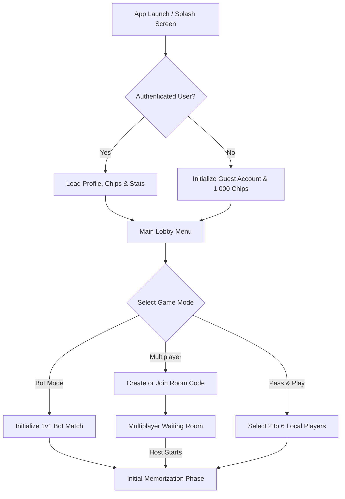
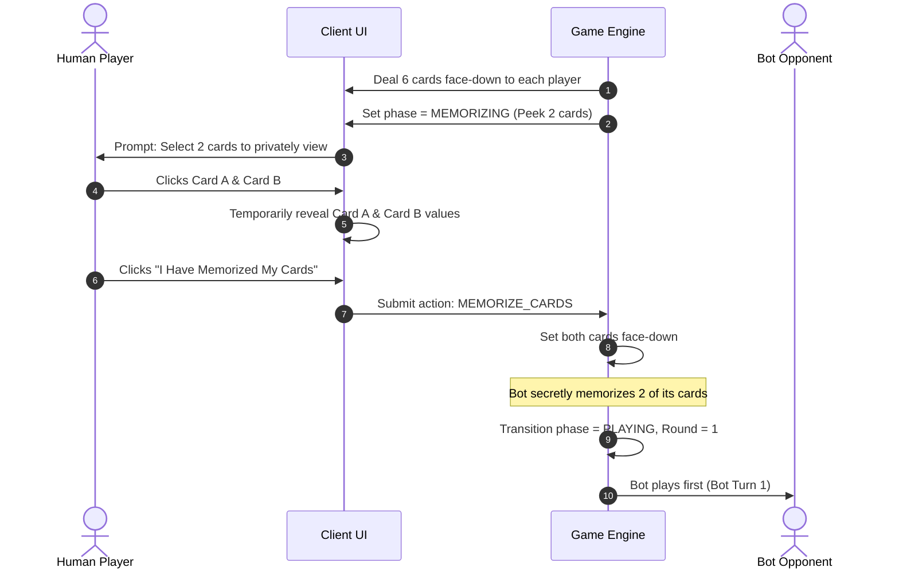
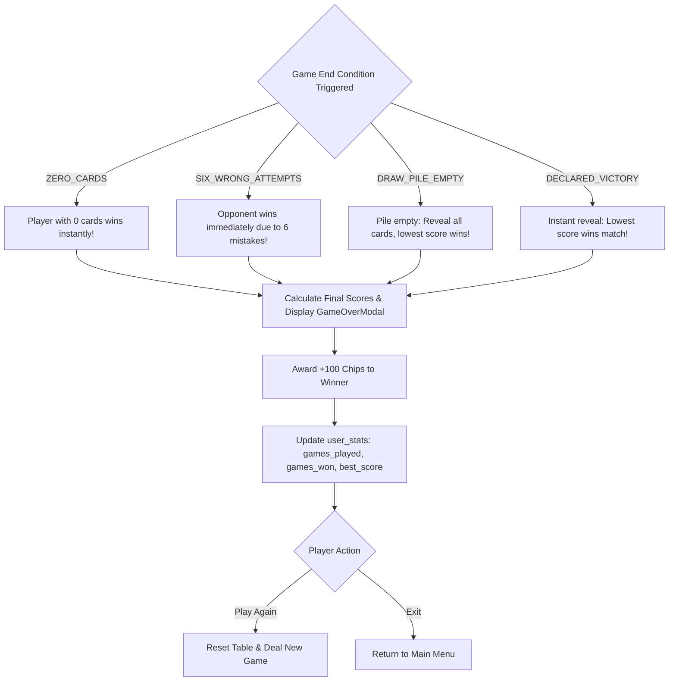
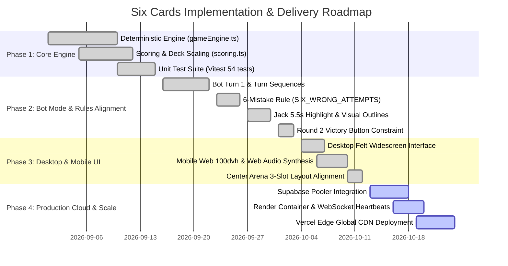

# 🃏 Six Cards — Master System Specification & Architecture

**Document Version:** 2.0.0  
**Classification:** Enterprise Engineering Architecture & Product Specification  
**Author:** Senior Principal Software Engineer  
**Target Systems:** `backend/` (Node.js/Socket.IO/PostgreSQL), `frontend/` (React Desktop SPA), `frontend-mobile/` (React Mobile Web SPA)  
**Status:** Approved & Implemented  

---

## 📑 Table of Contents
1. [Product Requirement (PRD)](#1-product-requirement-prd)
2. [Technical Requirement (TRD)](#2-technical-requirement-trd)
3. [App Flow & User Journeys](#3-app-flow--user-journeys)
4. [Design Brief & UI/UX Design System](#4-design-brief--uiux-design-system)
5. [Background Schema & Data Contracts](#5-background-schema--data-contracts)
6. [Implementation Plan & Engineering Roadmap](#6-implementation-plan--engineering-roadmap)

---

# 1. Product Requirement (PRD)

### 1.1 Executive Vision & Product Summary
**Six Cards** is a strategic, imperfect-information multiplayer card game engineered for modern web platforms (Desktop and Mobile Web). Blending elements of spatial memory, tactical card replacement, numeric value matching, and high-stakes psychological bluffing, the game tasks players with managing a 6-card grid where cards remain predominantly face-down.

Players must minimize their hand score or achieve an instantaneous clean-sweep elimination, while balancing risk against opponent discards and game-altering card abilities.

### 1.2 Target Personas
- **The Casual Mobile Player:** Seeks fast 3-to-5 minute matches on mobile browsers (`100dvh`), tactile card interactions, clear visual feedback, and intuitive touch targets.
- **The Competitive Card Strategist:** Thrives on card counting, probability tracking, memorizing opponent actions, and exploiting ability cards (7, 8, Jack) to disrupt opponent layouts.
- **The Social Circle:** 2 to 6 friends connecting remotely via 4-character room codes or playing together in a local Pass & Play session.

### 1.3 Core Objective & Game Mechanics
1. **Primary Objective:** End the game with the **lowest cumulative hand point score**, or achieve an **instant zero-card clean sweep** by eliminating all cards in hand.
2. **Initial Hand Setup:** Each player receives **6 face-down cards** arranged in numbered positions 1 through 6.
3. **Memorization Phase:** Before turns begin, each player privately inspects **exactly 2 of their 6 cards**. These cards are returned face-down; the remaining 4 cards remain mysteries until revealed through play.
4. **Card Point Values:**
   - **King (K):** `0 pts` (Best card in the game).
   - **Ace (A):** `1 pt`.
   - **2 through 9:** Face value (`2` to `9 pts`).
   - **10 & Queen (Q):** `10 pts` each.
   - **Jack (J):** `40 pts` (Highest penalty risk card; holds the special Blind Exchange power).
5. **Special Card Abilities (Triggered ONLY when drawn from Draw Pile):**
   - **7 — Peek Self:** Inspect 1 of your own face-down cards.
   - **8 — Peek Opponent:** Inspect 1 of an opponent's face-down cards.
   - **Jack — Blind Exchange:** Swap 1 of your hand cards with 1 opponent card without looking at either card value beforehand.

---

### 1.4 Game Modes
| Mode | Player Count | Platform Architecture | Key Distinction |
| :--- | :---: | :--- | :--- |
| **System AI (Bot Mode)** | 1v1 | Client or Server Engine | Deterministic bot with memory heuristics, rapid turn resolution, and specialized 1v1 rules. |
| **Online Multiplayer** | 2 to 6 Players | Centralized WebSocket Server | Real-time Socket.IO rooms, 4-letter join codes, card privacy encryption over network. |
| **Pass & Play** | 2 to 6 Players | Single Device Local Session | Hand-off transition screens ensuring private card inspection between physical players. |

---

### 1.5 Bot Mode Specific Product Specifications (1v1 Rules)
In 1v1 Bot Mode (Human vs. System AI), the rules are calibrated for competitive balance and rapid gameplay:

1. **Bot-First Turn Sequence:**
   - The bot always executes the first move (`Bot Turn 1`).
   - The human player plays second (`Player Turn 1`).
2. **Round 1 Lifecycle:**
   - Round 1 completes strictly after both the Bot and Human have taken 1 turn each.
3. **Victory Button Visibility Constraint:**
   - The **Victory** button is strictly **hidden during Round 1**.
   - It becomes visible and active from **Round 2 onward**, persisting until match completion.
4. **Discard Pile Restriction (No Option 2):**
   - Option 2 (*"Replace from Discard Pile"*) is **disabled in Bot Mode**.
   - The Discard Pile is utilized exclusively as an elimination target or landing pad for discarded cards.
5. **Point-Value Matching Elimination:**
   - Hand cards can be eliminated if their rank or point value matches the top card of the Discard Pile (e.g., a Queen [10 pts] matches a 10 [10 pts]; King matches King).
   - **Penalty for Failed Elimination:** 1 penalty card is drawn from the Draw Pile into the player's hand, and the mistake counter increments.
6. **Six Mistakes Automatic Defeat (`SIX_WRONG_ATTEMPTS`):**
   - If any player commits **6 incorrect elimination attempts**, that player **immediately loses the match**.
   - The opponent is declared winner instantly, irrespective of card scores.
7. **Center Table Layout (3 Dedicated Slots):**
   - **Left Slot:** Draw Pile (starts with 40 cards after dealing 6 cards to each player).
   - **Middle Slot:** Drawn Card display.
   - **Right Slot:** Discard Pile (face-up top card).
8. **Jack Exchange Visual Indication:**
   - When a Jack blind exchange occurs, a pulsing highlight border illuminates the two exchanged card positions for **5.0 to 6.0 seconds** (default 5.5s) without exposing card faces.
9. **Instant Victory Resolution:**
   - Declaring Victory immediately triggers full hand reveal and score tallying.
   - Lowest total score wins immediately; no final round or undercut penalty applies in Bot Mode.

---

### 1.6 Metagame, Economy & Progression
- **Starting Bankroll:** 1,000 complimentary chips upon registration/guest initialization.
- **Match Victory Reward:** +100 bonus chips upon winning any game mode.
- **Referral Engine:** Unique referral codes (`REF-XXXX`). Both referrer and referee receive +100 bonus chips upon sign-up.
- **Leaderboard & Records:** Global career tracking covering Total Victories, Win Rate %, Lowest Score, and Zero-Card Clean Sweeps.

---

# 2. Technical Requirement (TRD)

### 2.1 Technology Stack & System Topology
```text
┌────────────────────────────────────────────────────────────────────────┐
│                              CLIENT TIER                               │
│  ┌───────────────────────────────┐  ┌───────────────────────────────┐  │
│  │    Desktop Web Application    │  │    Mobile Web Application     │  │
│  │     React 19 + TypeScript     │  │     React 19 + TypeScript     │  │
│  │   Vite 8 SPA (Port 5173)      │  │  Vite 8 SPA (100dvh, P.5180)  │  │
│  └───────────────┬───────────────┘  └───────────────┬───────────────┘  │
└──────────────────┼──────────────────────────────────┼──────────────────┘
                   │ HTTPS (Static CDN)               │ WSS / REST APIs
                   ▼                                  ▼
      ┌─────────────────────────┐        ┌─────────────────────────────┐
      │     VERCEL EDGE CDN     │        │     RENDER WEB SERVICE      │
      │   Global Asset Hosting  │        │   Node.js 20+ / Express 4   │
      │  Desktop & Mobile Apps  │        │  Socket.IO 4.8 / TypeScript │
      └─────────────────────────┘        └──────────────┬──────────────┘
                                                        │
                                      PostgreSQL (SSL)  │ Transaction Pooler: 6543
                                                        ▼
                                         ┌─────────────────────────────┐
                                         │       SUPABASE CLOUD        │
                                         │   PostgreSQL 16 Database    │
                                         │ Relational Tables & Indices │
                                         └─────────────────────────────┘
```

### 2.2 Client-Side Engineering Specifications
- **Desktop Frontend (`frontend/`):**
  - **Framework:** React 19, TypeScript 5.8+, Vite 8.
  - **Design System:** Vanilla CSS with custom CSS design tokens; zero runtime CSS-in-JS overhead; zero Tailwind bloat.
  - **Icons:** `lucide-react`.
  - **Responsive Layout:** Dynamic felt poker table with dual hand visualization (Grid 2×3 vs Line 1×6).
- **Mobile Frontend (`frontend-mobile/`):**
  - **Framework:** React 19, TypeScript 5.8+, Vite 8.
  - **Audio Synthesis Engine:** Native `Web Audio API` generating procedural synthesizers for card dealing, flips, ability triggers, errors, and fanfare with zero network asset latency.
  - **Touch & Viewport:** 100% dynamic viewport height (`100dvh`), iOS bounce inhibition, min 44px touch targets.

### 2.3 Backend Server Specifications (`backend/`)
- **Runtime:** Node.js 20 LTS with `tsx` TypeScript engine.
- **HTTP & WebSocket Framework:** Express 4 + Socket.IO 4.8.
- **Multi-Environment Profiles (`profiles.ts`):**
  - `dev`: Local PostgreSQL database with automated fallback.
  - `test`: In-memory mock repositories and Vitest test harness.
  - `prod`: Supabase PostgreSQL pooler with SSL connection pooling.
- **Room Lifecycle Management:** In-memory room registry with automated dead room garbage collection (15-minute inactivity TTL).

### 2.4 Privacy Masking & Fair Play Architecture
To prevent browser devtools memory inspection or network packet sniffing:
1. When game state broadcasts to clients, **hidden cards are strictly sanitized** at the server boundary:
   ```typescript
   // Opponent's hidden card broadcast payload:
   {
     id: "c-102",
     position: 2,
     isFaceUp: false,
     rank: "?",
     suit: "?",
     value: 0
   }
   ```
2. Card ranks, suits, and numeric values are only transmitted when a card is legitimately revealed via action, ability, or final game reveal.

### 2.5 Reliability, Concurrency & SLA Targets
- **Turn Latency:** Local UI response < 16ms (60 FPS); WebSocket turn propagation < 150ms roundtrip.
- **Connection Resilience:** Socket.IO ping-pong every 25s; auto-reconnect with state re-synchronization within 5 attempts.
- **Engine Determinism:** 100% pure function state transitions in `gameEngine.ts` guaranteeing identical outcomes given the same sequence of actions.

---

# 3. App Flow & User Journeys

### 3.1 Global Navigation & Onboarding Flow


---

### 3.2 Pre-Game Setup & Memorization Phase


---

### 3.3 Core In-Game Turn Life Cycle (Bot Mode)
```mermaid
graph TD
    StartRound[Round Begins] --> TurnCheck{Whose Turn?}
    TurnCheck -->|Bot| BotTurn[Bot Turn 1]
    TurnCheck -->|Human| PlayerTurn[Player Turn 1]

    subgraph Human Turn Life Cycle
        PlayerTurn --> PAction{Player Selects Action}
        
        %% Action 1: Matching Elimination
        PAction -->|Option 1: Eliminate| PSelectElim[Select Hand Card & Discard Card]
        PSelectElim --> PElimVerify{Point Values Match?}
        PElimVerify -->|Match| PElimSuccess[Card Permanently Eliminated! Hand Shrinks]
        PElimVerify -->|Mismatch| PElimFail[Penalty: Draw 1 Card + Mistake Counter++]
        PElimFail --> PMistakeCheck{Mistakes >= 6?}
        PMistakeCheck -->|Yes| InstantDefeat[Game Over: SIX_WRONG_ATTEMPTS]
        PMistakeCheck -->|No| EndTurn[End Turn]
        PElimSuccess --> HandEmptyCheck{Hand Empty?}
        HandEmptyCheck -->|Yes| ZeroCardWin[Game Over: ZERO_CARDS Victory]
        HandEmptyCheck -->|No| EndTurn

        %% Action 2: Draw from Pile
        PAction -->|Option 2: Draw Card| PDraw[Draw Card from Center Pile]
        PDraw --> PDrawSub{Choose Draw Sub-Action}
        PDrawSub -->|Replace Hand Card| PReplace[Swap into Hand Slot face-down]
        PDrawSub -->|Discard Directly| PDiscard[Place face-up on Discard Pile]
        PDrawSub -->|Trigger Ability| PAbility{Is Card 7, 8, or Jack?}
        PAbility -->|7: Peek Self| PPeekSelf[View 1 Own Card]
        PAbility -->|8: Peek Opponent| PPeekOpp[View 1 Opponent Card]
        PAbility -->|Jack: Exchange| PJackExchange[Swap Hand Card with Opponent Card]
        PJackExchange --> PJackHighlight[Trigger 5.5s Pulsing Border Highlight]

        %% Action 3: Declare Victory
        PAction -->|Option 3: Declare Victory| PVictoryBtn{Round >= 2?}
        PVictoryBtn -->|Yes| PDeclareWin[Declare Victory: Instant Reveal & Score Tally]
        PVictoryBtn -->|No (Round 1)| PVictoryHidden[Button is Hidden]
    end

    PReplace --> EndTurn
    PDiscard --> EndTurn
    PPeekSelf --> EndTurn
    PPeekOpp --> EndTurn
    PJackHighlight --> EndTurn
    EndTurn --> AdvanceTurn[Switch Active Player / Advance Round]
```

---

### 3.4 Game Over & Scoring Settlement Flow


---

# 4. Design Brief & UI/UX Design System

### 4.1 Aesthetic Philosophy
The visual design embodies a **Neo-Casino Luxury / Glassmorphic High-Tech** aesthetic. The atmosphere balances the tactile immersion of classic high-stakes poker clubs with ultra-clean, modern geometric interfaces.

### 4.2 Color Palette & Design Tokens
```css
:root {
  /* Surface & Canvas Tokens */
  --felt-green-deep: #0a2e1d;        /* Main casino table background */
  --felt-green-surface: #0f3d27;     /* Elevated panel and player mat */
  --felt-green-border: rgba(16, 185, 129, 0.25);
  
  /* Brand & Metallic Accents */
  --gold-primary: #f59e0b;           /* Amber/Gold badges, active turn outlines */
  --gold-glow: rgba(245, 158, 11, 0.4);
  --gold-light: #fbbf24;
  
  /* Card Aesthetics */
  --card-back-bg: #1e293b;           /* Obsidian slate for face-down cards */
  --card-face-bg: #ffffff;           /* Clean white card surface */
  --suit-red: #ef4444;               /* Hearts and Diamonds */
  --suit-black: #0f172a;             /* Spades and Clubs */
  
  /* State & Alert Tokens */
  --danger-crimson: #ef4444;         /* Mistakes badge, elimination errors */
  --success-emerald: #10b981;        /* Match elimination success */
  --jack-highlight: #38bdf8;         /* Cyan pulsing glow for Jack exchange */
}
```

### 4.3 Center Arena Layout & Geometry (3 Dedicated Slots)
The central game arena is organized into three balanced interactive zones:
```text
┌────────────────────────────────────────────────────────────────────────┐
│                          CENTER TABLE ARENA                            │
│                                                                        │
│   ┌──────────────────┐   ┌──────────────────┐   ┌──────────────────┐   │
│   │   SLOT 1 (LEFT)  │   │  SLOT 2 (CENTER) │   │  SLOT 3 (RIGHT)  │   │
│   │    DRAW PILE     │   │    DRAWN CARD    │   │   DISCARD PILE   │   │
│   │                  │   │                  │   │                  │   │
│   │   ┌──────────┐   │   │   ┌──────────┐   │   │   ┌──────────┐   │   │
│   │   │ 🂠 Cards  │   │   │   │ 🂡 Active │   │   │   │ 🂮 Top    │   │   │
│   │   │ Count:40 │   │   │   │  Action  │   │   │   │  Target  │   │   │
│   │   └──────────┘   │   │   └──────────┘   │   │   └──────────┘   │   │
│   │                  │   │                  │   │                  │   │
│   │   Primary Deck   │   │ Drawn Inspection │   │ Elimination Base │   │
│   └──────────────────┘   └──────────────────┘   └──────────────────┘   │
└────────────────────────────────────────────────────────────────────────┘
```
1. **Slot 1 (Left) — Draw Pile:**
   - Face-down card stack with dynamic badge indicator (e.g., `40 cards`).
   - Interactive trigger for `DRAW` action.
2. **Slot 2 (Center) — Drawn Card Slot:**
   - Displays the currently drawn card during `DRAWN_PENDING` sub-phase.
   - Shows action buttons: `Replace Hand Card`, `Discard`, or `Trigger Ability`.
3. **Slot 3 (Right) — Discard Pile:**
   - Shows the top face-up card with clear rank and suit indicators.
   - Target zone for matching eliminations and card discards.

---

### 4.4 Hand Visualizations: Grid View vs. Line View
To accommodate varying screen ratios and player preferences, the hand displays support instant switching between two layouts:
- **Grid View (2×3 Matrix):**
  - Positions 1, 2, 3 on top row; Positions 4, 5, 6 on bottom row.
  - Optimal for desktop screens and spatial coordinate memorization.
- **Line View (1×6 Strip):**
  - Horizontal scrolling card strip.
  - Optimal for one-handed mobile scanning.

---

### 4.5 Micro-Animations & Interactive Feedback
1. **Jack Blind Exchange Highlight (`.jack-highlight-card`):**
   - When a Jack ability is played, a pulsating cyan glow border (`#38bdf8`) outlines the two affected card slots for exactly **5.5 seconds**.
   - Card values remain completely face-down throughout the highlight duration.
2. **Mistake Counter Escalation Badge:**
   - Displayed inside the player mat: `⚠️ Mistakes: {count}/6`.
   - At count 0–3: Subdued slate/yellow badge.
   - At count 4–5: Flashing crimson badge warning of impending automatic defeat.
   - At count 6: Instant screen shake transition to the GameOverModal.
3. **Round 2 Victory Button Transition:**
   - Hidden during Round 1 (`display: none` / omitted from DOM).
   - Animates smoothly into view at the start of Round 2 with an amber glow border.
4. **Synthesized Web Audio Engine (Mobile):**
   - **Card Deal:** 150Hz sine pluck with low-pass filter (30ms).
   - **Card Flip:** 800Hz quick click/snap (15ms).
   - **Successful Match:** Harmonic dual-tone chime (523Hz + 659Hz).
   - **Mistake Penalty:** 110Hz saw dissonance burst with downward frequency slide.
   - **Victory:** 3-stage major chord fanfare (C5 - E5 - G5 - C6).

---

# 5. Background Schema & Data Contracts

### 5.1 Database Entity Relationship Diagram (PostgreSQL)

```mermaid
erDiagram
    users ||--o| user_stats : "has 1:1"
    users ||--o{ friends : "has many"
    users ||--o{ room_participants : "participates in"
    users ||--o{ connections : "owns active"
    rooms ||--o{ room_participants : "contains"
    rooms ||--o{ game_history : "logs into"

    users {
        varchar id PK
        varchar username UK
        varchar avatar
        varchar auth_provider
        varchar referral_code UK
        varchar referred_by FK
        int referral_count
        int chips
        bigint created_at
        bigint updated_at
    }

    user_stats {
        varchar user_id PK,FK
        int games_played
        int games_won
        int best_score
        int zero_card_wins
        bigint updated_at
    }

    friends {
        bigserial id PK
        varchar user_id FK
        varchar friend_id FK
        bigint created_at
    }

    rooms {
        varchar room_code PK
        varchar host_user_id FK
        varchar status
        jsonb config
        jsonb game_state
        bigint created_at
        bigint updated_at
    }

    room_participants {
        bigserial id PK
        varchar room_code FK
        varchar user_id FK
        varchar socket_id
        boolean is_host
        bigint joined_at
    }

    connections {
        varchar socket_id PK
        varchar user_id FK
        bigint connected_at
        bigint last_heartbeat
    }

    game_history {
        varchar id PK
        varchar room_code
        varchar mode
        bigint start_time
        bigint end_time
        varchar end_reason
        jsonb winner_ids
        jsonb participants
        int round_count
        bigint created_at
    }

    app_logs {
        bigserial id PK
        timestamptz timestamp
        varchar level
        varchar source
        varchar category
        text message
        jsonb metadata
    }
```


---

### 5.2 Production PostgreSQL DDL Schema (`schema.sql`)
```sql
-- 1. USERS TABLE
CREATE TABLE IF NOT EXISTS users (
  id VARCHAR(64) PRIMARY KEY,
  username VARCHAR(100) NOT NULL UNIQUE,
  avatar VARCHAR(255) NOT NULL,
  auth_provider VARCHAR(50) DEFAULT 'guest',
  referral_code VARCHAR(50) UNIQUE NOT NULL,
  referred_by VARCHAR(64) REFERENCES users(id) ON DELETE SET NULL,
  referral_count INT DEFAULT 0,
  chips INT DEFAULT 1000,
  created_at BIGINT NOT NULL,
  updated_at BIGINT NOT NULL
);

CREATE INDEX IF NOT EXISTS idx_users_referral_code ON users(referral_code);
CREATE INDEX IF NOT EXISTS idx_users_username ON users(username);

-- 2. USER STATS TABLE
CREATE TABLE IF NOT EXISTS user_stats (
  user_id VARCHAR(64) PRIMARY KEY REFERENCES users(id) ON DELETE CASCADE,
  games_played INT DEFAULT 0,
  games_won INT DEFAULT 0,
  best_score INT DEFAULT 999,
  zero_card_wins INT DEFAULT 0,
  updated_at BIGINT NOT NULL
);

-- 3. FRIENDS TABLE
CREATE TABLE IF NOT EXISTS friends (
  id BIGSERIAL PRIMARY KEY,
  user_id VARCHAR(64) NOT NULL REFERENCES users(id) ON DELETE CASCADE,
  friend_id VARCHAR(64) NOT NULL REFERENCES users(id) ON DELETE CASCADE,
  created_at BIGINT NOT NULL,
  UNIQUE(user_id, friend_id)
);

CREATE INDEX IF NOT EXISTS idx_friends_user_id ON friends(user_id);
CREATE INDEX IF NOT EXISTS idx_friends_friend_id ON friends(friend_id);

-- 4. ROOMS TABLE
CREATE TABLE IF NOT EXISTS rooms (
  room_code VARCHAR(16) PRIMARY KEY,
  host_user_id VARCHAR(64) REFERENCES users(id) ON DELETE SET NULL,
  status VARCHAR(32) NOT NULL DEFAULT 'WAITING',
  config JSONB NOT NULL DEFAULT '{}'::jsonb,
  game_state JSONB DEFAULT NULL,
  created_at BIGINT NOT NULL,
  updated_at BIGINT NOT NULL
);

CREATE INDEX IF NOT EXISTS idx_rooms_status ON rooms(status);

-- 5. ROOM PARTICIPANTS TABLE
CREATE TABLE IF NOT EXISTS room_participants (
  id BIGSERIAL PRIMARY KEY,
  room_code VARCHAR(16) NOT NULL REFERENCES rooms(room_code) ON DELETE CASCADE,
  user_id VARCHAR(64) NOT NULL REFERENCES users(id) ON DELETE CASCADE,
  socket_id VARCHAR(128),
  is_host BOOLEAN DEFAULT FALSE,
  joined_at BIGINT NOT NULL,
  UNIQUE(room_code, user_id)
);

-- 6. ACTIVE CONNECTIONS TABLE
CREATE TABLE IF NOT EXISTS connections (
  socket_id VARCHAR(128) PRIMARY KEY,
  user_id VARCHAR(64) NOT NULL REFERENCES users(id) ON DELETE CASCADE,
  connected_at BIGINT NOT NULL,
  last_heartbeat BIGINT NOT NULL
);

-- 7. GAME HISTORY TABLE
CREATE TABLE IF NOT EXISTS game_history (
  id VARCHAR(64) PRIMARY KEY,
  room_code VARCHAR(16),
  mode VARCHAR(32) NOT NULL,
  start_time BIGINT NOT NULL,
  end_time BIGINT NOT NULL,
  end_reason VARCHAR(64),
  winner_ids JSONB NOT NULL DEFAULT '[]'::jsonb,
  participants JSONB NOT NULL DEFAULT '[]'::jsonb,
  round_count INT NOT NULL DEFAULT 1,
  created_at BIGINT NOT NULL
);

-- 8. SYSTEM APPLICATION LOGS
CREATE TABLE IF NOT EXISTS app_logs (
  id BIGSERIAL PRIMARY KEY,
  timestamp TIMESTAMPTZ NOT NULL DEFAULT NOW(),
  level VARCHAR(16) NOT NULL,
  source VARCHAR(32) NOT NULL DEFAULT 'backend',
  category VARCHAR(64) NOT NULL DEFAULT 'GENERAL',
  message TEXT NOT NULL,
  metadata JSONB DEFAULT '{}'::jsonb
);
```

---

### 5.3 Runtime In-Memory Engine State Schema (`types/game.ts`)
```typescript
export type Suit = '♠' | '♥' | '♦' | '♣';
export type Rank = 'A' | '2' | '3' | '4' | '5' | '6' | '7' | '8' | '9' | '10' | 'J' | 'Q' | 'K';

export interface Card {
  id: string;
  suit: Suit;
  rank: Rank;
  value: number;
  isFaceUp: boolean;
  position: number;
}

export interface Player {
  id: string;
  name: string;
  cards: Card[];
  isBot: boolean;
  memorizedCardIndices: number[];
  score: number;
  hasDeclaredVictory: boolean;
  incorrectEliminationCount: number; // Increments on wrong elimination (Max 6)
  connected: boolean;
}

export type GamePhase = 'MEMORIZING' | 'PLAYING' | 'FINAL_ROUND' | 'GAME_OVER';

export type TurnSubPhase =
  | 'TURN_START'
  | 'DRAWN_PENDING'
  | 'ABILITY_PEEKING_OWN'
  | 'ABILITY_PEEKING_OPPONENT'
  | 'ABILITY_SWAPPING_JACK';

export interface JackHighlightState {
  playerCardPosition: number;
  opponentCardPosition: number;
  expiresAt: number; // Unix timestamp for 5.5s highlight
}

export interface GameState {
  id: string;
  players: Player[];
  activePlayerIndex: number;
  drawPile: Card[];
  discardPile: Card[];
  eliminatedCards: Card[];
  phase: GamePhase;
  turnSubPhase: TurnSubPhase;
  drawnCard: Card | null;
  roundNumber: number;
  declarerPlayerIndex: number | null;
  firstPlayerIndex: number;
  jackHighlight: JackHighlightState | null;
  log: ActionLogEntry[];
  config: GameConfig;
  endReason?: 'ZERO_CARDS' | 'DECLARED_VICTORY' | 'DRAW_PILE_EMPTY' | 'SIX_WRONG_ATTEMPTS';
}
```

---

### 5.4 WebSocket Real-Time Event Protocol
| Event Name | Direction | Payload Structure | Purpose |
| :--- | :---: | :--- | :--- |
| `create_room` | Client $\rightarrow$ Server | `{ user: UserProfile, config?: Partial<GameConfig> }` | Host creates a new 4-letter multiplayer lobby. |
| `join_room` | Client $\rightarrow$ Server | `{ roomCode: string, user: UserProfile }` | Participant joins existing lobby. |
| `start_game` | Client $\rightarrow$ Server | `{ roomCode: string }` | Host initiates card dealing and starts match. |
| `game_action` | Client $\rightarrow$ Server | `{ roomCode: string, action: GameAction }` | Dispatches player move (Draw, Discard, Ability, etc.). |
| `room_update` | Server $\rightarrow$ Client | `{ roomCode: string, participants: Participant[], isHost: boolean }` | Broadcasts lobby member changes. |
| `game_state_update` | Server $\rightarrow$ Client | `{ state: GameState (Privacy-Sanitized) }` | Authoritative state sync broadcast. |
| `error` | Server $\rightarrow$ Client | `{ message: string, code?: string }` | Relays validation or network exception to client. |

---

# 6. Implementation Plan & Engineering Roadmap

### 6.1 Phased Execution Timeline



---

### 6.2 Deliverables Breakdown by Phase

#### Phase 1: Core Engine & Deterministic Game Logic *(Completed & Verified)*
- [x] Implement pure functional state machine in `gameEngine.ts`.
- [x] Implement point-value scoring and elimination checks in `scoring.ts`.
- [x] Implement multi-deck scaling for 2 to 6 players in `deck.ts`.
- [x] Author comprehensive 54-test Vitest test suite achieving 100% pass rate.

#### Phase 2: Bot Mode & Real-Time AI Rules Alignment *(Completed & Verified)*
- [x] Configure bot-first turn sequence: Bot executes Turn 1; Human executes Turn 1.
- [x] Constrain Victory button: strictly hidden in Round 1, visible from Round 2 onward.
- [x] Eliminate Option 2 (*"Replace from Discard"*) in Bot Mode; reserve discard strictly for elimination.
- [x] Implement 6-Mistake instant defeat rule (`SIX_WRONG_ATTEMPTS`) with visual warning badges.
- [x] Implement Jack blind exchange 5.5s pulsing outline highlight (`.jack-highlight-card`).
- [x] Implement instant victory reveal and scoring settlement without undercut penalty for Bot Mode.

#### Phase 3: Desktop & Mobile Web Frontend Parity *(Completed & Verified)*
- [x] Layout parity: Top panel pinned to opponent/bot, bottom panel pinned to human player.
- [x] Center Arena: Re-align into 3 designated slots (Left Draw Pile [starts 40 cards], Middle Drawn Card, Right Discard Pile).
- [x] Implement dual view toggle: Grid View (2×3) and Line View (1×6 horizontal strip).
- [x] Build latency-free procedural sound synthesis engine using native Web Audio API in `frontend-mobile/`.
- [x] Verification audit: 21 mobile screens, dialogs, and game states verified in `docs/MOBILE_APP_SCREENS_AND_TEST_REPORT.md`.

#### Phase 4: Cloud Database & Persistence Architecture *(Production Ready)*
- [x] Design PostgreSQL relational schema covering users, career statistics, friendships, room states, and logs.
- [x] Implement repository pattern with transaction safety in `backend/src/db/repositories/`.
- [x] Implement profile auto-switching (`dev` local PG vs `prod` Supabase pooler).
- [x] Verify live services on Node.js port 3001 and Mobile Vite port 5180.

#### Phase 5: Production Deployment & Observability Runbook *(Next Steps)*
- [ ] Connect production Supabase database via transaction pooler port 6543.
- [ ] Deploy backend container to Render Web Service with SSL websockets.
- [ ] Deploy Desktop and Mobile SPAs to Vercel Edge CDN with custom domains.
- [ ] Configure Datadog / Papertrail external logging and automated uptime pings.

---

### 6.3 Quality Assurance & Verification Matrix
| Layer | Verification Target | Test Method | Pass Criteria |
| :--- | :--- | :--- | :--- |
| **Engine** | Rule enforcement, abilities, scoring, 6 mistakes | Automated Vitest (`npm test`) | 54/54 tests passing; zero regressions. |
| **Types** | Type safety across 3 workspaces | `tsc --noEmit` | 0 errors across backend, frontend, frontend-mobile. |
| **Network** | Card privacy during multiplayer | Packet inspection | Hidden card values never transmitted over wire until revealed. |
| **UI/UX** | Mobile touch responsiveness & 100dvh | Browser Subagent / DevTools | Zero viewport jitter, touch targets $\ge 44\text{px}$, 60 FPS transitions. |
| **Resilience** | WebSocket disconnections & reconnect | Chaos socket kill | Client rehydrates current game state without table desync. |

---

### 6.4 Production Rollback & Disaster Recovery Strategy
1. **Blue/Green Deployments:** Vercel instant rollback provides sub-second reversion to previous build hashes for frontend SPAs.
2. **Database Migrations:** All SQL table modifications are non-destructive (e.g. `ADD COLUMN IF NOT EXISTS`).
3. **Stateless WebSocket Graceful Shutdown:**
   - Server traps `SIGTERM` / `SIGINT`.
   - Informs active rooms of impending maintenance.
   - Flushes unwritten user stats to PostgreSQL pool before exiting.
